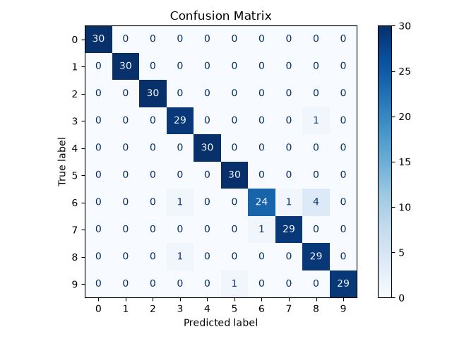

# Spoken Digit Classifier
A from-scratch implementation of simple spoken digit classifier using **Mel-Frequency Cepstral Coefficients (MFCC)** and **Gaussuan Mixture Models (GMM)** trained via the **Expectation-Maximization (EM)** algorithm.

## Overview
The aim of this project was to develop from scratch the whole recording classification pipeline consisting of preprocessing of spoken digit recordings, feature extraction and classfication. The model was evaluated on the [Free Spoken Digit Dataset](https://github.com/Jakobovski/free-spoken-digit-dataset) [1].

The functions for processing the recordings and training the GMMs were developed almost entirely using only NumPy.

## Pipeline
The classification pipeline consists of the following stages:
1. **Audio loading:** Load labeled recordings from the Free Spoken Digit Dataset.
2. **Preprocessing:** Standardize the audio representation and optionally remove silence.
3. **Feature extraction:** Convert the waveform into MFCC feature vectors.
4. **Model training:** Fit one GMM for each digit class.
5. **Classification:** Score the test recordings against each digit model and select the highest-scoring class.
6. **Evaluation:** Measure classification accuracy and plot the confusion matrix.

## Preprocessing and feature extraction details

### Preprocessing
The preprocessing stage prepares raw audio recordings for feature extraction.

Implemented operations:
- **Peak normalization:** Scale waveform according to its maximum absolute value.
- **Preemphasis:** First-order FIR filter used to emphasize higher-frequency components.
- **Voice activity detection:** Optionally identify speech-active regions by comparing each frame's energy to the mean energy of the whole recording.

### Feature extraction
The feature extraction pipeline converts each waveform into a matrix of Mel-Frequency Cepstral Coefficients (MFCC).

Implemented operations:
- **Short-Time Fourier Transform (STFT)**:
    - Framing
    - Applying periodic Hamming window
    - Computing FFT on windowed signal
- **Mel filterbank:**
    - Converting frequencies from Hertz to Mel using the HTK convention [2]:

      $$
      Mel(f)=2595\log_{10}\left(1+\frac{f}{700}\right)
      $$

    - Constructing Mel filterbank.
    - Applying the filterbank to the power spectrum to obtain Mel filterbank energies.
- **Cepstral analysis:**
    - Computing logarithm of Mel filterbank energies.
    - Applying the Discrete Cosine Transform (DCT-II) to obtain the MFCC.
- **Temporal derivatives:**
    - Computing first- and second-order derivatives of MFCC (delta and delta-delta coefficients)

## Classiffication
MFCC feature vectors are concatenated for each digit class and a separate Gaussian Mixture Model (GMM) is then trained for each digit using the Expectation-Maximization (EM) algorithm to model the feature distribution.

Implemented operations:

- **Expectation-Maximization algorithm:** The algorithm is implemented as follows [3]:

    1. **Initialization:** Initialize the mixture weights uniformly, select observations randomly as the initial component means and initialize all covariance matrices using the global sample covariance. Evaluate the initial log-likelihood.

    2. **Expectation step (E-step):** Evaluate the responsibilities using the current mixture weights, mean vectors and covariance matrices. To prevent numerical underflow, computations necessary for this step are performed in log-space.

    3. **Maximization step (M-step):** Update the mixture weights, mean vectors and covariance matrices using the responsibilities computed in the E-step. A small diagonal regularization term is added to each covariance matrix to improve numerical conditioning.

    4. **Log-likelihood evaluation:** Recompute the observed-data log-likelihood using the updated parameters and repeat the E-step and M-step until the convergence criterion is satisfied or the maximum number of iterations is reached.

- **Mean log-likelihood scoring:** For a new recording, compute the log-likelihood of each feature vector under the trained GMM and sum the values across all frames. Divide the total log-likelihood by the number of feature vectors to obtain the mean log-likelihood per observation. The predicted digit is the class whose GMM yields the highest mean log-likelihood.

## Results
The model achieved **96.7% accurracy** with the recordings split into train and test sets according to the official Free Spoken Digit Dataset split, where recordings numbered 0-4 belong to the test set and the rest of the recordings belongs to the train set [1].



The confusion matrix shows that the model performed the worst in classification of digit 6, which was confused with digit 8.

## Setup
Clone the repository:

   ```bash
   git clone https://github.com/r-powalka/spoken_digit_classifier
   ```

Install the project and its dependencies:

```bash
cd spoken_digit_classifier
pip install .
```

Download Free Spoken Digit Dataset:

```bash
python scripts/download_fsdd.py
```
   
## Usage
Run the classification pipeline from the project root:

```bash
python -m spoken_digits.main
```

## References
[1] J. S. K. (Jakobovski), *Free Spoken Digit Dataset (FSDD)*. GitHub repository. Available: https://github.com/Jakobovski/free-spoken-digit-dataset

[2] S. Young et al., *The HTK Book*.

[3] C. M. Bishop, *Pattern Recognition and Machine Learning*. New York: Springer, 2006

